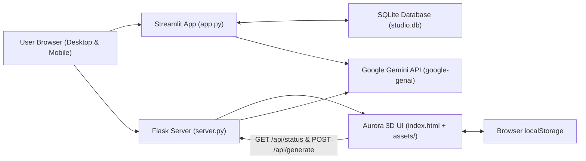

# Product Studio AI — Product Content Generation System

**Project ID:** `GENAI-AGENT-020`  
**Project Title:** Product Content Generation System  
**Application Name:** Product Studio AI

Product Studio AI is a Generative AI marketing workspace powered by **Google Gemini** that transforms structured product details into marketing descriptions, SEO metadata, social media captions, marketing emails, and FAQs using **Indian Rupee (`INR ₹`)** pricing. The project provides two connected interfaces: a **Streamlit + SQLite** application (`app.py`) and an **Aurora 3D Flask + HTML** nine-page web workspace (`server.py` + `index.html`).

---

## Live Deployments & Repository

| Resource | URL |
| :--- | :--- |
| **Streamlit Application** | https://genai-agent-020.streamlit.app |
| **Aurora 3D Website** | https://product-studio-aurora.onrender.com |
| **GitHub Repository** | https://github.com/mgowthamroyal-ux/genai-agent-020 |

---

## Table of Contents

- [Project Overview](#project-overview)
- [Problem Statement](#problem-statement)
- [Objectives](#objectives)
- [Key Features](#key-features)
- [Technology Stack](#technology-stack)
- [System Architecture](#system-architecture)
- [Folder Structure](#folder-structure)
- [Installation & Setup](#installation--setup)
- [Gemini API Configuration](#gemini-api-configuration)
- [Application Workflow](#application-workflow)
- [Known Limitations](#known-limitations)
- [Future Enhancements](#future-enhancements)

---

## Project Overview

Product Studio AI streamlines product copywriting and campaign preparation through two complementary interfaces that link directly to each other:

1. **Streamlit Edition (`app.py`)**: A 4-page Python application featuring a **Navy & Gold** design (with **Dark** and **Light** theme modes), responsive desktop and mobile navigation, Google Gemini integration via the `google-genai` SDK, and persistent draft storage in **SQLite (`studio.db`)**.
2. **Aurora 3D Web Edition (`index.html` + `server.py`)**: A 9-page web workspace served by **Flask** featuring an animated blue, cyan, and gold Aurora background with floating 3D golden spheres, **Dark** and **Brighter Glow (Light)** themes, browser `localStorage` persistence, client-side SEO quality scoring, and live `/api/generate` calls to Google Gemini (with an offline template fallback when no API key is active).

---

## Problem Statement

E-commerce sellers, product managers, and marketing teams frequently spend considerable time manually writing product descriptions, search engine metadata, social captions, and promotional emails across growing product catalogs. Manual drafting often leads to:
- Inconsistent brand tone across channels.
- Unintentional invention of unsupported technical specifications.
- Inconsistent currency formatting for regional markets such as India (`INR ₹`).
- Fragmented workflows across drafting, SEO checking, competitor tracking, and campaign planning.

---

## Objectives

- Build an intuitive Generative AI workspace that generates tailored marketing copy from structured product facts.
- Enforce grounded generation prompts that instruct Google Gemini **not** to invent specifications and to format prices in **INR (`₹`)**.
- Provide persistent draft storage and export capabilities (`SQLite` in Streamlit; `localStorage`, `.txt`, and `.json` exports in the web workspace).
- Support responsive usability across desktop, tablet, and mobile viewports (`360px`, `390px`, `430px`, and wider screens) in both dark and light themes.
- Protect API credentials using server-side `.env` configuration and error-message masking so keys are never exposed to the browser or UI.

---

## Key Features

### 1. Streamlit Application (`app.py`) — 4 Pages
- **Dashboard**: Displays live draft counts from `studio.db`, supported content types (`6`), active AI provider (`Gemini`), currency (`INR ₹`), recent saved drafts, and a direct link to the Aurora 3D Website. Metrics automatically adapt into a **2×2 grid** when content width is constrained.
- **Content Studio**: Accepts product name, price (`INR`), features, content type (`Product description`, `SEO title`, `Meta description`, `Instagram caption`, `Marketing email`, `FAQs`), brand tone (`Professional`, `Friendly`, `Luxury`, `Persuasive`, `Minimal`), additional instructions, and an explicit API consent checkbox. Supports inline editing, SQLite saving, and `.txt` download.
- **Saved Content**: Displays all drafts stored in the `drafts` table of `studio.db` with `.txt` download and record deletion.
- **Settings**: Reports Gemini provider/model configuration status (without revealing the API key), system details, technology stack metrics, and repository link.
- **Responsive Navigation & Themes**: Includes sidebar navigation, mobile quick-navigation buttons, Dark/Light theme switching, and high-contrast status alerts.

### 2. Aurora 3D Web Application (`index.html` + `server.py`) — 9 Pages
- **Dashboard**: Aurora hero banner, 4 workspace KPI cards, category distribution chart with filter, recent activity feed, featured brand strip, and 6 preloaded sample catalog products backed by local `assets/` images.
- **Products**: Register, edit, search, filter by company, and delete products with a 2×2 form layout and optional local image upload (`< 1.5 MB` converted to data URI).
- **Content Studio**: Product preview, tone and type selectors, live Gemini generation via `POST /api/generate` (with user confirmation prompt and offline template fallback), editable draft pane, `localStorage` save, and `.txt` export.
- **SEO Optimizer**: Generates SEO titles, meta descriptions, and keywords; provides an illustrative search-result snippet preview and a rule-based `0–100` on-page check (title length `30–60`, description length `120–160`, primary keyword presence, keyword suggestions, and phrase density).
- **Competitors**: Manual competitor price (`INR`) and research notes comparison table.
- **Calendar**: Campaign post scheduling with publish date and channel notes.
- **Analytics**: Category distribution progress bars and saved draft activity table.
- **Reports**: Printable workspace inventory report (`Print / Save as PDF`) and `.json` workspace export.
- **Admin**: System status summary, `.json` backup export, Dark/Brighter Glow theme toggle, mobile hamburger drawer + Prev/Next page buttons, and a direct sidebar link to the Streamlit app.

---

## Technology Stack

| Layer | Technology | Purpose |
| :--- | :--- | :--- |
| **Language** | Python 3, HTML5, CSS3, JavaScript (ES6+) | Core application logic and web UI |
| **AI Engine** | Google Gemini (`google-genai` SDK) | Marketing & SEO content generation |
| **Streamlit UI** | `streamlit>=1.40` | Native Python multi-page workspace (`app.py`) |
| **Web Backend** | `flask>=3` | Serves `index.html`, `/assets/*`, and `/api/*` (`server.py`) |
| **Persistence** | SQLite (`studio.db`) & Browser `localStorage` | Draft storage in Streamlit; client workspace state in HTML |
| **Configuration** | `python-dotenv>=1` | Loads `GEMINI_API_KEY` and `GEMINI_MODEL` from `.env` |

---

## System Architecture



### API Endpoints (`server.py`)
- `GET /` — Serves `index.html`.
- `GET /assets/<path:filename>` — Serves static product photos and brand SVGs from `assets/`.
- `GET /api/status` — Returns `{ live, provider, model }` configuration status without exposing any secret key.
- `POST /api/generate` — Validates JSON product payload and invokes `google.genai.Client` with server-side `GEMINI_API_KEY` and grounded system instructions.

---

## Folder Structure

```text
Product_Studio_Full_Aurora/
├── app.py                  # Streamlit 4-page application (Navy & Gold, SQLite drafts)
├── server.py               # Flask server for Aurora 3D UI & Gemini /api/* endpoints
├── index.html              # 9-page Aurora 3D web workspace (CSS + JS + embedded defaults)
├── studio.db               # SQLite database storing saved drafts (gitignored)
├── requirements.txt        # Python dependencies
├── .env.example            # Sample environment file template
├── .gitignore              # Excludes .env, *.db, __pycache__, virtualenvs
├── IMAGE_SOURCES.txt       # Attribution notes for the 6 sample product images
├── README.md               # Project documentation
└── assets/                 # Local product photos and brand icons
    ├── product-1.jpg       # Sony WH-1000XM5
    ├── product-2.jpg       # Apple Watch Series 10
    ├── product-3.jpg       # Galaxy S25 Ultra
    ├── product-4.jpg       # Nike Sportswear Backpack
    ├── product-5.jpg       # boAt Rockerz 450
    ├── product-6.jpg       # Apple MacBook Air M4
    ├── apple.com.svg
    ├── boat-lifestyle.com.svg
    ├── nike.com.svg
    ├── samsung.com.svg
    ├── sony.com.svg
    └── hero.svg
```

---

## Installation & Setup

### Prerequisites
- Python 3.10 or newer (tested with Python 3.14)
- A Google Gemini API key from Google AI Studio

### 1. Clone the Repository
```bash
git clone https://github.com/mgowthamroyal-ux/genai-agent-020.git
cd genai-agent-020
```

### 2. Create a Virtual Environment & Install Dependencies
**Windows (PowerShell):**
```powershell
py -m venv .venv
.\.venv\Scripts\Activate.ps1
py -m pip install -r requirements.txt
```

**macOS / Linux:**
```bash
python3 -m venv .venv
source .venv/bin/activate
python3 -m pip install -r requirements.txt
```

### 3. Run the Applications Locally
**Run the Streamlit App (`app.py`):**
```powershell
py -m streamlit run app.py
```

**Run the Aurora 3D Flask Website (`server.py` + `index.html`):**
```powershell
py server.py
```
Then open `http://127.0.0.1:8000` in your browser.

---

## Gemini API Configuration

Create a `.env` file in the project root directory (never commit `.env` to version control; it is excluded by `.gitignore`).

```env
GEMINI_API_KEY=your_gemini_api_key_here
GEMINI_MODEL=gemini-3.5-flash-lite
```

> **Note:** Both `app.py` and `server.py` read `GEMINI_API_KEY` and `GEMINI_MODEL` (defaulting to `gemini-3.5-flash-lite` if omitted) via `python-dotenv`. Keep `.env` private and configure the same environment variables in your hosting platform's secret manager (Streamlit Community Cloud Secrets / Render Environment Variables) when deploying.

---

## Application Workflow

1. **Configure Environment**: Set `GEMINI_API_KEY` in `.env` (or deployment secrets) and verify status on the **Settings** page (Streamlit) or header status badge (Aurora Web).
2. **Select or Register Product**: Enter product details in **Content Studio** (Streamlit) or manage catalog items in **Products** (Aurora Web) with `INR (₹)` pricing.
3. **Choose Format & Tone**: Pick the target format (`Product description`, `SEO title`, `Meta description`, `Instagram caption`, `Marketing email`, or `FAQs`) and desired brand tone.
4. **Generate & Refine**: Confirm API usage and generate copy via Google Gemini. Review and edit the output directly in the draft editor.
5. **Save & Export**: Persist drafts to `studio.db` (`app.py`) or `localStorage` (`index.html`), download `.txt` / `.json` files, or run rule-based SEO checks and campaign scheduling in the Aurora Web workspace.

---

## Known Limitations

- **Separate Storage Backends**: `app.py` persists drafts in SQLite (`studio.db`), whereas `index.html` stores products, drafts, competitors, and scheduled posts in browser `localStorage`. Data is not shared between the two interfaces.
- **Static File Mode (`file://`)**: Opening `index.html` directly without `server.py` runs in offline template demo mode rather than live Gemini AI generation.
- **Rule-Based SEO & Manual Competitors**: The SEO Optimizer score (`0–100`) and search preview are rule-based/illustrative rather than live search-engine metrics, and competitor entries are recorded manually.
- **Local Server Hardening**: `server.py` is designed for local development and single-user deployment without user authentication or rate limiting.
- **Streamlit Hosting Chrome**: When deployed on Streamlit Community Cloud, host-rendered floating platform controls (such as the bottom-right "Manage app" button outside the app `<iframe>`) are controlled by the hosting platform and cannot be removed from `app.py`.

---

## Future Enhancements

- Unify `index.html` and `app.py` persistence behind a shared backend database API.
- Add user authentication and multi-workspace support for team deployments.
- Support batch CSV/catalog content generation for multiple products at once.
- Add automated unit and end-to-end regression tests in CI.
- Integrate structured brand-guideline presets and multi-language Indian regional copy generation.
